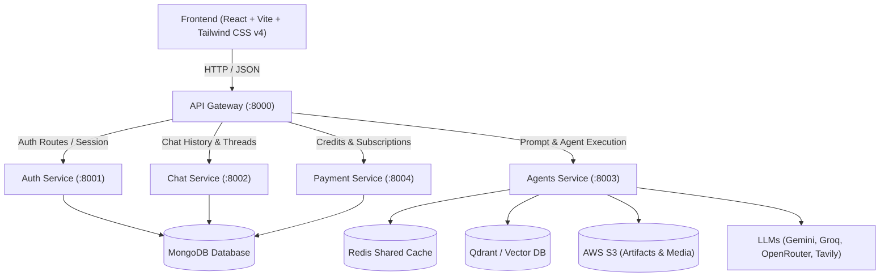

# OnyxAI — Multi-AI Agent Distributed Platform

An enterprise-grade, distributed multi-agent AI orchestration platform engineered with microservices architecture, LangGraph workflows, and a minimalist ChatGPT-inspired interface. OnyxAI dynamically routes, executes, and streams intelligent responses across specialized autonomous agents—including Coding, PDF RAG & Analysis, Presentation Generation, Computer Vision, and Real-Time Web Intelligence.

---

## 🌟 Key Features

### 🧠 Autonomous Multi-Agent Orchestration
- **Smart Intent Router (Auto Mode):** Powered by LangGraph state machines, dynamically classifying user intent on every turn to route requests to the most optimal specialized agent.
- **Specialized AI Agents:**
  - **Auto Router:** Autonomous orchestration choosing the right agent based on real-time task understanding.
  - **Chat Agent:** General conversation, deep reasoning, and multi-turn contextual memory.
  - **Coding Agent:** Architecture design, algorithm implementation, full-stack debugging, and syntax-highlighted code generation with one-click copy.
  - **PDF & Document RAG Agent:** Semantic document question answering, parsing, chunking, and vector-backed document comprehension.
  - **Presentation (PPT) Agent:** Generates downloadable Microsoft PowerPoint presentations (`.pptx`) dynamically using `pptxgenjs`.
  - **Image & Vision Analyzer:** Multimodal visual processing, deep image analysis, and visual question answering.
  - **Web Intelligence (Search):** Real-time web search and grounded factual queries integrated with Tavily and live image card carousels.

### 🎙️ ChatGPT-Grade Conversation Experience
- **Real-Time Voice Input:** Native speech-to-text integration with real-time waveform visualization powered by the browser's Web Audio API (`AnalyserNode`).
- **Midnight-Blue User Message Bubbles:** Styled with refined `#243B60` surfaces, clean rounded corners, and fluid text wrapping.
- **Unboxed, Clean Typography for AI:** Left-aligned, distraction-free markdown typesetting (`#ECECEC`) with syntax-highlighted code blocks, responsive tables, and markdown lists.
- **Document & Artifact Panel:** Dedicated preview and download triggers for generated PDF documents, PowerPoint presentations, and code artifacts.

### 🏢 Cloud-Native Distributed Microservices
- **API Gateway:** Centralized routing, CORS management, request validation, authentication checking, and reverse proxy forwarding with `http-proxy-middleware`.
- **Auth Service:** Secure token-based authentication and user identity management powered by Firebase Admin SDK and MongoDB.
- **Chat Service:** Conversation history persistence, pagination, thread management, and metadata tracking.
- **Agents Service:** Distributed LLM pipeline utilizing LangChain, LangGraph, Google Gemini, Groq, and OpenRouter.
- **Payment Service:** Credit ledger system and subscription payment gateway powered by Razorpay.
- **Distributed State & Caching:** Redis-backed caching and message passing with MongoDB persistence.

---

## 🏗️ Architecture Overview



---

## 🛠️ Technology Stack

| Domain | Technologies |
| :--- | :--- |
| **Frontend** | React 19, Vite, Tailwind CSS v4, Redux Toolkit, React Markdown, Rehype Highlight, Web Audio API |
| **Backend & Microservices** | Node.js (ES Modules), Express 5, `http-proxy-middleware`, Multer |
| **AI Orchestration & Agents** | LangGraph, LangChain, Google Generative AI (Gemini), Groq, OpenRouter, Tavily Search |
| **Vector & RAG** | Qdrant Vector Store, PDF-Parse, PDFKit, PPTXGenJS |
| **Databases & Cache** | MongoDB (Mongoose 9), Redis |
| **Authentication & Payments** | Firebase Admin SDK, Razorpay API |
| **Cloud & DevOps** | Docker, AWS ECS Fargate, AWS ECR, AWS S3, AWS Service Connect |

---

## 📂 Repository Structure

```
MultiAiAgentPlatform/
├── frontend/                     # React + Vite client application
│   ├── src/
│   │   ├── components/           # MessageBubble, ChatArea, VoiceRecorder, SideBar, TopBar
│   │   ├── config/               # Agent modes & theme configuration
│   │   ├── contexts/             # ChatContext & global state
│   │   ├── hooks/                # useChat, useSpeechToText
│   │   └── redux/                # Redux slices (conversation, user, store)
│   └── package.json
│
└── backend/                      # Distributed backend services
    ├── gateway/                  # Central API Gateway & Reverse Proxy
    ├── shared/                   # Shared Redis clients and utilities
    └── services/
        ├── Agents/               # LangGraph multi-agent service & routing
        │   ├── agents/           # Specialized agent definitions (Chat, Coding, PDF, PPT, Vision)
        │   └── graph/            # LangGraph router, state, and execution graphs
        ├── Auth/                 # Firebase authentication & profile service
        ├── Chat/                 # Conversation & message storage service
        └── Payment/              # Razorpay credit management & billing
```

---

## 🚀 Getting Started

### Prerequisites
- **Node.js**: v20+ or v22+
- **MongoDB**: Local instance or MongoDB Atlas URI
- **Redis**: Local instance or cloud Redis endpoint
- **API Keys**: Google Gemini API, Groq, OpenRouter, Tavily, Firebase Service Account, and Razorpay

### 1. Clone the Repository
```bash
git clone https://github.com/quantum0059/MultiAiAgentPlatform.git
cd MultiAiAgentPlatform
```

### 2. Configure Environment Variables

Create `.env` files in each service directory (`backend/gateway/.env`, `backend/services/Agents/.env`, `backend/services/Auth/.env`, `backend/services/Chat/.env`, `backend/services/Payment/.env`, and `frontend/.env`).

#### Example: `backend/services/Agents/.env`
```env
PORT=8003
MONGO_URI=mongodb+srv://<username>:<password>@cluster.mongodb.net/onyx_agents
REDIS_URL=redis://localhost:6379
GEMINI_API_KEY=your_gemini_api_key
GROQ_API_KEY=your_groq_api_key
OPENROUTER_API_KEY=your_openrouter_api_key
TAVILY_API_KEY=your_tavily_api_key
AWS_ACCESS_KEY_ID=your_aws_key
AWS_SECRET_ACCESS_KEY=your_aws_secret
AWS_REGION=ap-southeast-2
S3_BUCKET_NAME=your_s3_bucket
```

### 3. Local Development

#### Start the Microservices:
```bash
# Gateway
cd backend/gateway && npm install && npm run dev

# Agents Service
cd backend/services/Agents && npm install && npm run dev

# Auth Service
cd backend/services/Auth && npm install && npm run dev

# Chat Service
cd backend/services/Chat && npm install && npm run dev

# Payment Service
cd backend/services/Payment && npm install && npm run dev
```

#### Start the Frontend Client:
```bash
cd frontend && npm install && npm run dev
```
Open [http://localhost:5173](http://localhost:5173) in your browser.

---

## 🐳 Docker & Cloud Deployment

Each microservice contains an optimized `Dockerfile` ready for container orchestration:

```bash
# Build the Agents service container
cd backend
docker build --platform linux/amd64 -t onyx-agents:latest -f services/Agents/Dockerfile .

# Run container locally
docker run -p 8003:8003 --env-file services/Agents/.env onyx-agents:latest
```

The services are deployed to **AWS ECS Fargate** behind **AWS ECR** and linked via **AWS ECS Service Connect** for zero-latency, private service discovery.

---

## 👤 Author

**Shivam Sharma**  
GitHub: [@quantum0059](https://github.com/quantum0059)  
LinkedIn: [Shivam Sharma](https://linkedin.com)
